<div align="center">

# 🏗️ SiteGo

**Construction site monitoring & management — attendance, materials, reports, issues and AI quality checks in one app.**


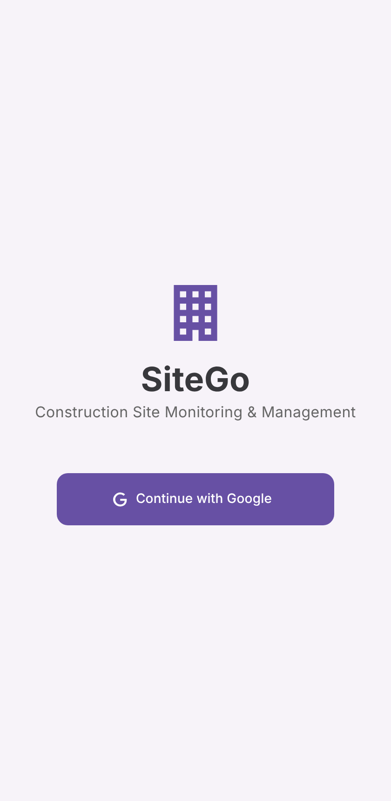
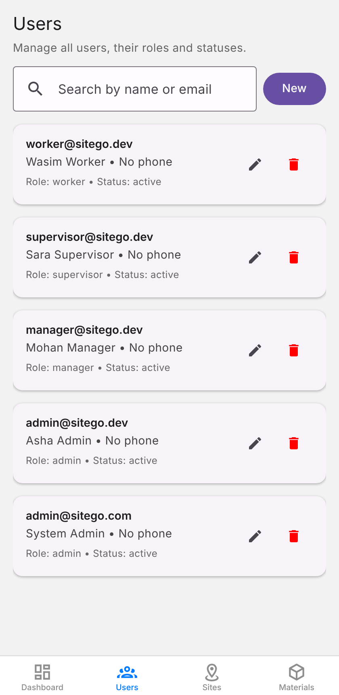
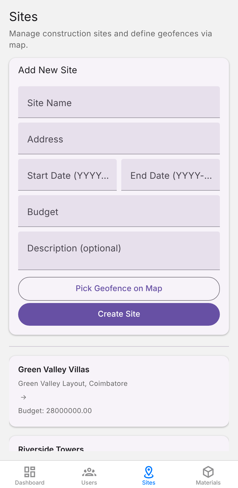

</div>

---

## ✨ Features

| | |
|---|---|
| 🔐 **Google sign-in + JWT** | OAuth login, short-lived access tokens, refresh tokens |
| 👥 **Role-based access** | `worker`, `supervisor`, `manager`, `admin`, each with their own app experience |
| 📍 **Geofenced attendance** | Check-in / check-out validated against a site polygon |
| 🧱 **Material tracking** | Material master, QR-based scan logging, per-site inventory |
| 📝 **Daily reports** | Submit, review, approve or reject |
| ⚠️ **Issue tracking** | Create, assign, comment and move issues through a workflow |
| 🤖 **AI quality checks** | TensorFlow.js image classifier (cracks, misalignment, plastering, missing safety gear…) |
| 🐳 **One-command deploy** | Docker Compose for DB + API + web app, plus GitHub Actions CI |

## 🧭 Architecture

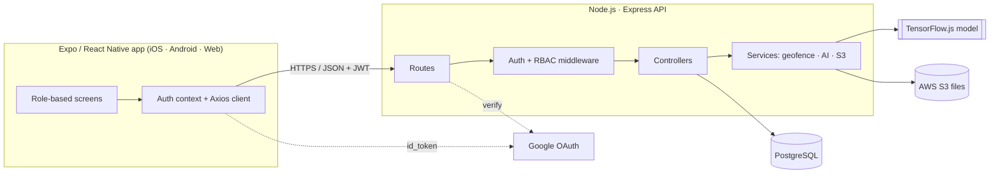

## 👤 Roles

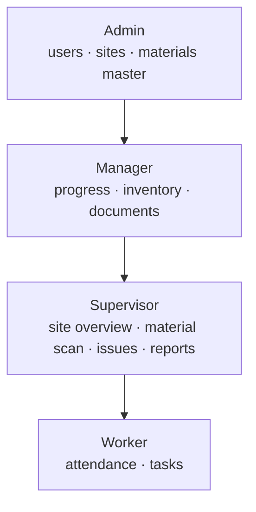

## 🔑 Sign-in flow

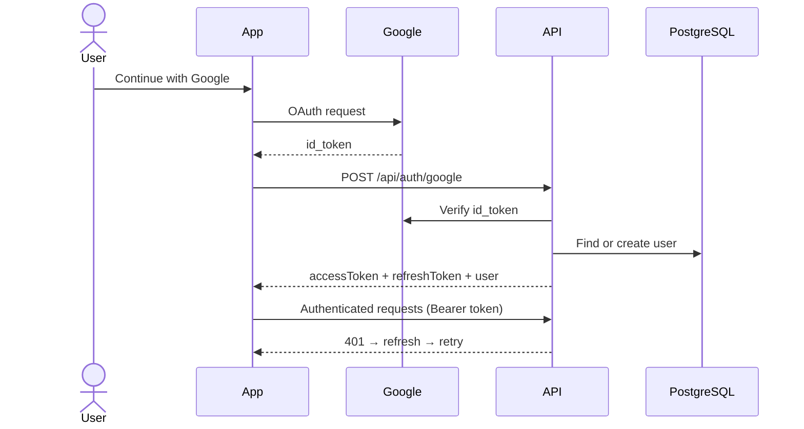

## 📍 Geofenced attendance

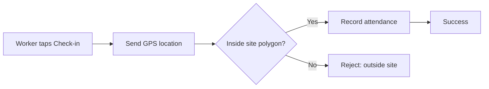

## 🗄️ Data model

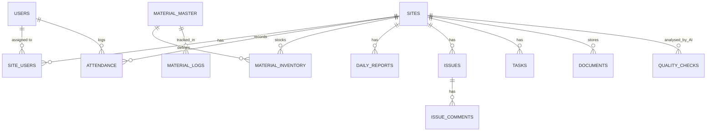

## 📸 Screenshots

Captured from the web build running against the real API and a seeded database.

| Login | Admin · Dashboard | Admin · Users |
|:---:|:---:|:---:|
|  | 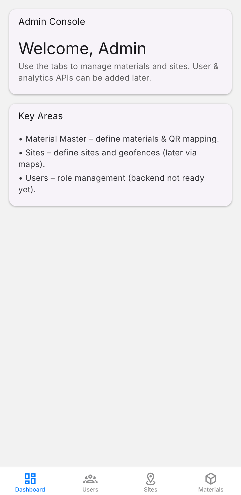 |  |

| Admin · Sites | Admin · Materials | Supervisor · Overview |
|:---:|:---:|:---:|
|  | 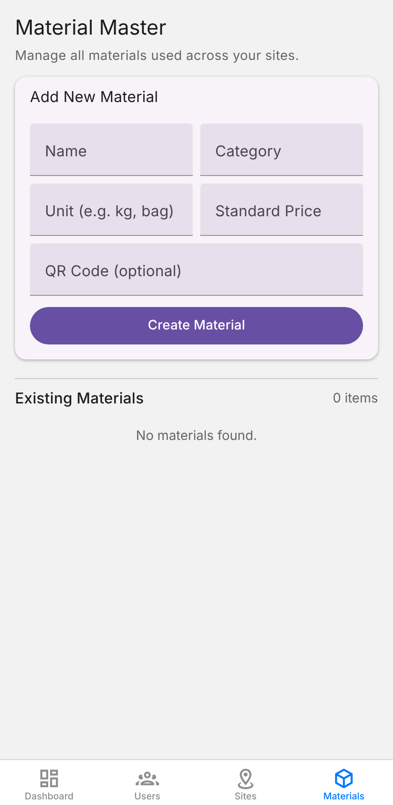 | 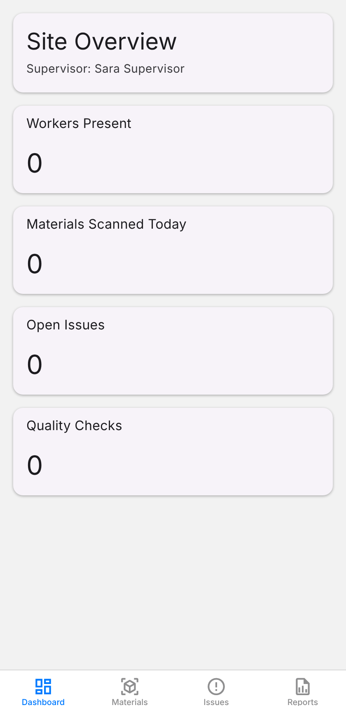 |

| Supervisor · Material scan | Worker · Home | Worker · Attendance |
|:---:|:---:|:---:|
| 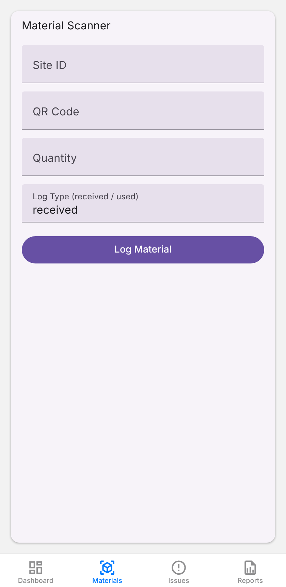 | 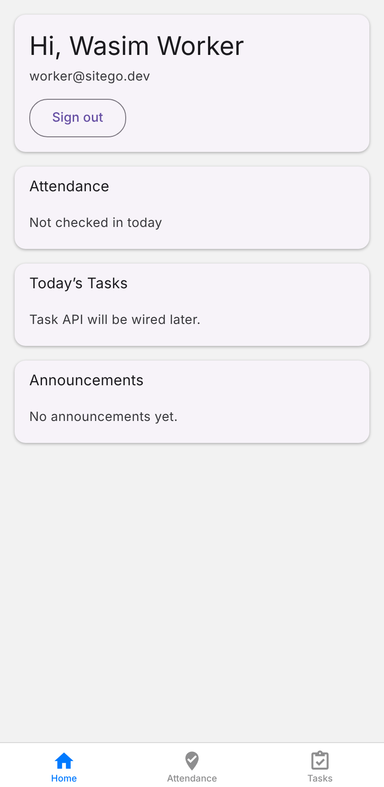 | 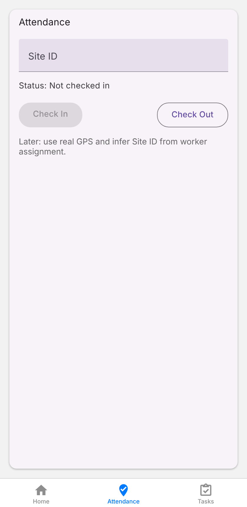 |

## 🚀 Getting started

### Option A — Docker (fastest)

```bash
git clone https://github.com/Santhosh-zeta/SiteGo.git && cd SiteGo
export JWT_SECRET=$(openssl rand -hex 32) JWT_REFRESH_SECRET=$(openssl rand -hex 32)
export GOOGLE_CLIENT_ID=your_client_id.apps.googleusercontent.com   # optional for API-only use
docker compose up --build
```

- Web app → http://localhost:8080
- API → http://localhost:5000/api (health: `/api/health`)

### Option B — Local development

**Prerequisites:** Node.js 20+, PostgreSQL 14+.

```bash
# 1. Backend
cd backend
cp .env.example .env          # fill in DB credentials, JWT secrets, Google client ID
npm install
npm run migrate               # creates the schema (safe to re-run)
npm run seed                  # optional demo users + sites
npm run dev                   # http://localhost:5000

# 2. Frontend (new terminal)
cd frontend
cp .env.example .env
npm install --legacy-peer-deps
npm run web                   # or: npm run android / npm run ios
```

### Configuration

| Variable | Where | Description |
|---|---|---|
| `DB_*` | backend | PostgreSQL connection |
| `JWT_SECRET`, `JWT_REFRESH_SECRET` | backend | Token signing keys — use long random values |
| `GOOGLE_CLIENT_ID` | backend | Audience for verifying Google ID tokens |
| `AI_MODEL_ENABLED` | backend | `false` uses mock predictions (no model required) |
| `AWS_*` | backend | Optional S3 storage for uploads |
| `EXPO_PUBLIC_API_URL` | frontend | API base URL |
| `EXPO_PUBLIC_GOOGLE_CLIENT_ID` | frontend | Google OAuth client ID |

See [`backend/.env.example`](backend/.env.example) and [`frontend/.env.example`](frontend/.env.example).

## 🔌 API

52 REST endpoints across auth, users, sites, attendance, materials, reports, issues and AI. Full reference: **[docs/API.md](docs/API.md)**.

## 🤖 AI quality model

The backend loads a TensorFlow.js model from `backend/ai_models/quality_check_model`. Training and conversion scripts live in [`backend/ai_models`](backend/ai_models) (`train_model.py`, `convert_to_tfjs.py`). Without a model the service falls back to mock predictions, so the app runs out of the box.

## 🗂️ Project structure

```
SiteGo/
├── backend/            Express API
│   ├── database/       SQL migrations, migrate + seed scripts
│   ├── ai_models/      Training / conversion scripts
│   └── src/            routes · controllers · middleware · services · utils
├── frontend/           Expo (React Native + Web) app
│   └── src/            screens · navigation · services · contexts
├── docs/               API reference, screenshots
├── docker-compose.yml  DB + API + web
└── .github/workflows/  CI
```

## 🛣️ Status & roadmap

SiteGo is an actively evolving project. The backend API, auth, migrations, admin console, material scanning and attendance flows work today. Still to build:

- [ ] Manager screens: progress charts, timeline, inventory, documents (currently placeholders)
- [ ] Worker tasks API and screen wiring
- [ ] Real GPS in the attendance screen (currently a fixed test location)
- [ ] Automated tests and linting
- [ ] Trained quality-check model shipped with the repo

## 🤝 Contributing & security

See [CONTRIBUTING.md](CONTRIBUTING.md) and [SECURITY.md](SECURITY.md).

## 📄 License

[MIT](LICENSE) © Santhosh-zeta
